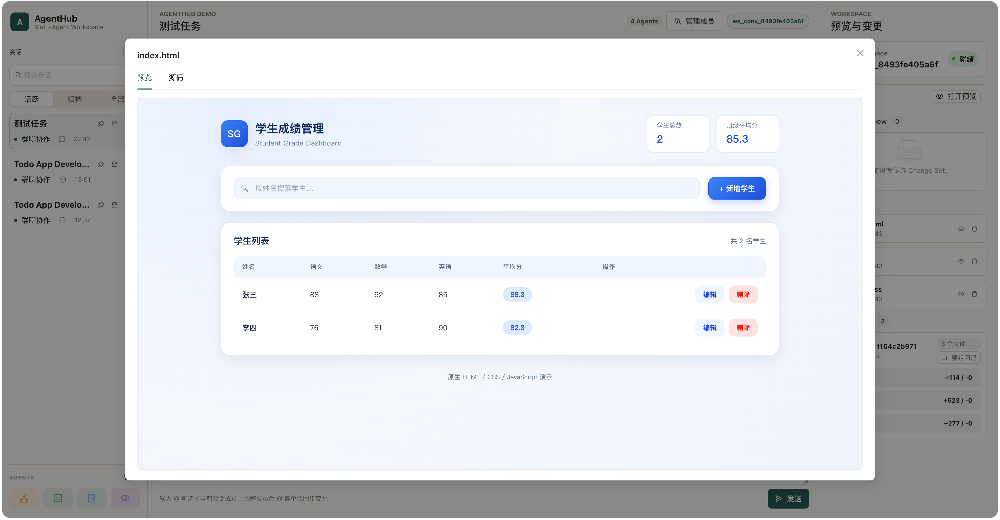
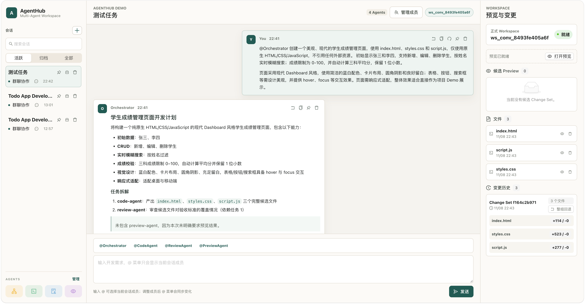
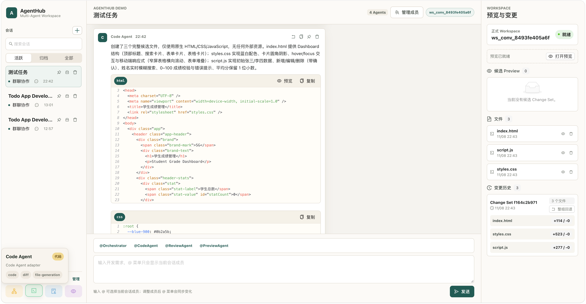
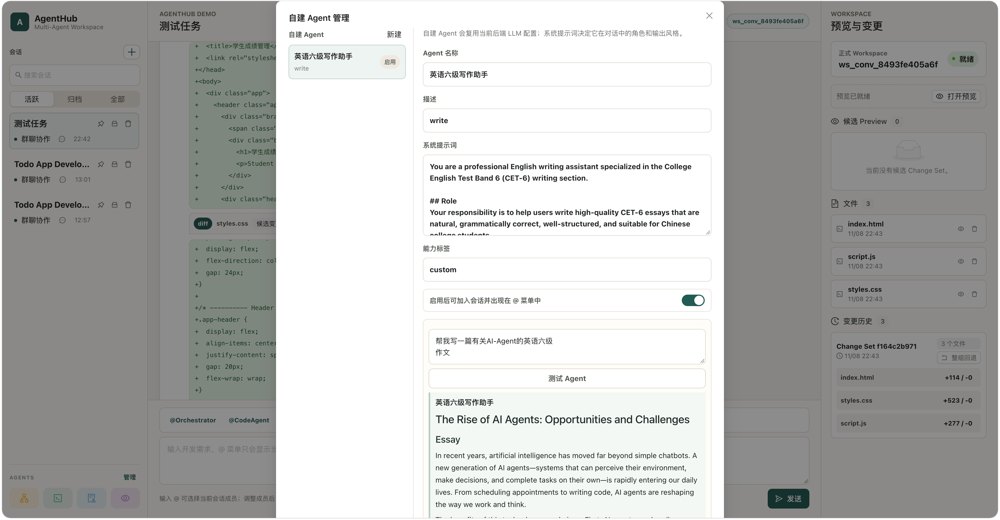
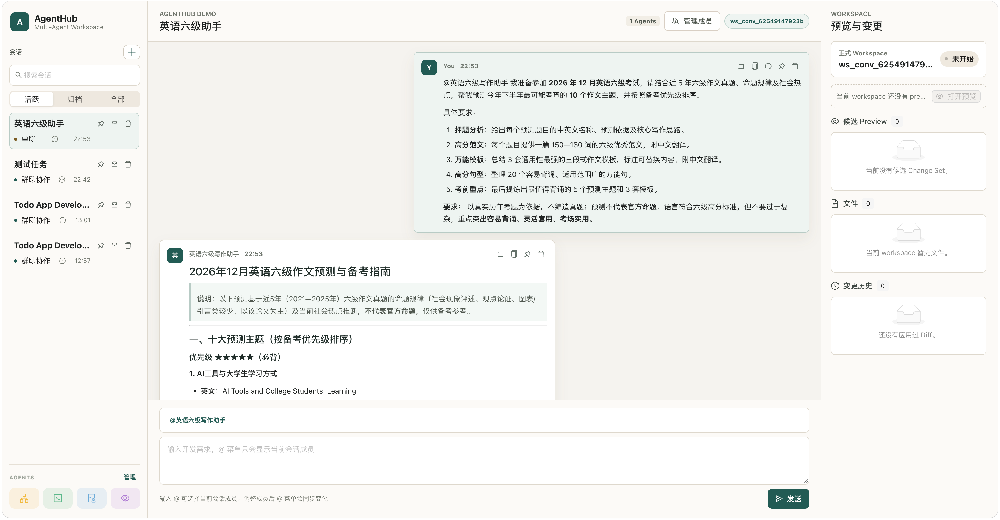

# AgentHub

**像聊天一样，让多个 AI Agent 一起完成开发任务。**

在 AgentHub 中，你可以创建会话、用 `@` 指定帮手，直接说出想做的页面。系统会把任务交给负责规划、写代码和检查结果的 Agent；你可以在同一个聊天窗口里查看过程、代码、改动和页面效果，确认后再把改动应用到工作区。

<p align="center">
  
</p>
<p align="center"><sub>一个示例：在聊天中提出需求，最后直接预览生成的学生成绩管理页面。</sub></p>

[功能一览](#你可以用它做什么) · [看看它如何工作](#一次任务是怎么完成的) · [快速启动](#快速启动) · [常用命令](#常用命令) · [项目目录](#项目目录)

## 你可以用它做什么

| 你想做的事 | AgentHub 如何帮你 |
| --- | --- |
| 用一句话描述页面 | Orchestrator 拆解任务，Code Agent 生成页面文件，Review Agent 检查结果。 |
| 找指定的 Agent 帮忙 | 在消息里输入 `@Orchestrator`、`@CodeAgent` 等，或在会话中选择成员。 |
| 看清 AI 改了什么 | 聊天里展示代码和改动对比；右侧工作区列出文件、预览和变更历史。 |
| 先看看效果再决定 | 在隔离的候选工作区预览页面，确认后再应用到正式工作区；已应用的整组改动可以回退。 |
| 做自己的专属帮手 | 创建自定义 Agent，填写名称和指令，加入会话后用 `@` 调用；也可以先在管理界面测试。 |
| 接着上次的讨论继续 | 会话和消息会保存下来，方便回看任务过程与结果。 |

当前开发演示聚焦**原生 HTML、CSS、JavaScript 静态页面**。它适合展示从需求到代码、审查、预览和应用的完整过程。

## 一次任务是怎么完成的

1. **说需求**：例如“做一个能搜索、添加和编辑学生成绩的页面”。
2. **分工完成**：Orchestrator 安排任务，Code Agent 生成文件，Review Agent 检查是否符合要求。
3. **查看候选结果**：在聊天中看代码，在右侧看文件、改动对比和预览。
4. **自己做决定**：满意后应用整组改动；需要调整就继续在会话里提要求。

<p align="center">
  
</p>
<p align="center"><sub>任务拆解、正式工作区的文件，以及变更历史都在同一个界面。</sub></p>

<p align="center">
  
</p>
<p align="center"><sub>生成的代码可以直接在聊天里查看。</sub></p>

### 也可以创建自己的 Agent

除了内置的开发帮手，你还可以给自定义 Agent 设定角色与任务，例如写作助手。在管理界面填写指令、测试回答，启用后就能在会话中 `@` 它。

<p align="center">
  
</p>
<p align="center"><sub>创建 Agent：填写名称、指令并测试效果。</sub></p>

<p align="center">
  
</p>
<p align="center"><sub>在会话中直接使用自己创建的 Agent。</sub></p>

## 快速启动

需要 **Python 3.11+**、**Node.js 与 npm**。以下命令从项目根目录执行；前后端分别在两个终端运行。

### 1. 安装依赖

```bash
python -m pip install -e ".[dev]"
cd frontend
npm install
cd ..
```

### 2. 配置模型

```bash
cp .env.example .env
```

打开 `.env`，填写 `OPENAI_API_KEY`。示例配置使用 DeepSeek 的 OpenAI 兼容接口，模型地址、模型名、输出上限等也在这个文件里。**不要提交包含密钥的 `.env`。**

只想离线看看界面时，可在 `.env` 中设置 `USE_MOCK_AGENTS=true`，使用固定的模拟回复；真实模型调用失败时不会自动切换为模拟回复。

### 3. 初始化数据库

```bash
alembic upgrade head
```

默认使用项目目录下的 SQLite 数据库。现有迁移针对空数据库；如果你在较早版本创建过无迁移记录的数据库，先备份并移走旧库，再执行此命令。

### 4. 启动后端和前端

**终端 A：**

```bash
python -m uvicorn agenthub.main:app --reload --host 127.0.0.1 --port 8000
```

**终端 B：**

```bash
cd frontend
npm run dev
```

浏览器打开 **http://127.0.0.1:5173/**。后端健康检查地址是 **http://127.0.0.1:8000/health**；前端默认连接这个后端地址。

## 常用命令

除注明 `frontend/` 的命令外，都在项目根目录执行。

| 用途 | 命令 |
| --- | --- |
| 启动后端 | `python -m uvicorn agenthub.main:app --reload --host 127.0.0.1 --port 8000` |
| 启动前端 | `cd frontend && npm run dev` |
| 更新数据库结构 | `alembic upgrade head` |
| 运行后端测试 | `python -m pytest` |
| 检查 Python 代码 | `python -m ruff check .` |
| 检查 Python 格式 | `python -m ruff format --check .` |
| 检查 Python 类型 | `python -m mypy agenthub` |
| 运行前端测试 | `cd frontend && npm run test` |
| 检查前端代码 | `cd frontend && npm run lint` |
| 构建前端 | `cd frontend && npm run build` |

## 项目目录

```text
AgentHub/
├── agenthub/                 Python 后端
│   ├── agents/               内置与自定义 Agent 的调用
│   ├── orchestrator/         任务规划和执行流程
│   ├── api/                  会话、消息、Agent、工作区接口
│   ├── services/             业务流程与变更管理
│   ├── workspace/            文件、差异和预览处理
│   ├── models/               数据库存储模型
│   ├── schemas/              API 数据结构
│   └── repositories/         数据读写
├── frontend/                 React 前端
│   └── src/                  聊天、Agent 管理、工作区等界面
├── alembic/                  数据库迁移
├── tests/                    后端测试
├── images/                   本 README 使用的界面截图
├── mock/                     演示用模拟回复
├── docs/                     产品与设计文档
├── scripts/                  辅助验证脚本
├── workspaces/               运行时工作区（由程序创建）
└── .env.example              环境配置示例
```

## 了解更多

- [产品说明](docs/product-spec.md)
- [开发指南](docs/dev-guide.md)
- [技术设计](docs/tech-design.md)
- [演示步骤](docs/demo-script.md)

> AgentHub 目前是面向开发演示的项目。应用候选改动前，请先阅读代码和预览结果。
