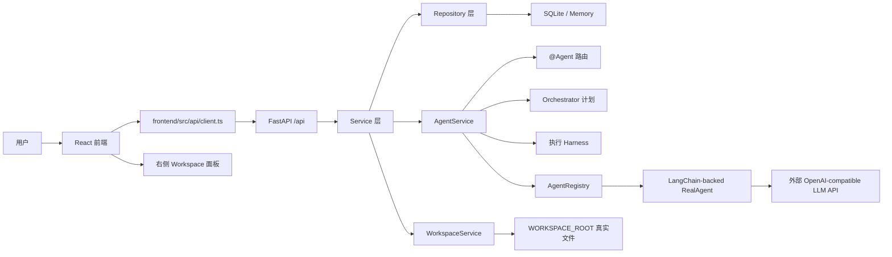

# AgentHub 项目整体架构与代码解读

最后更新：2026-06-07

本文面向第一次接触 AgentHub 的开发者。读完后应当能够理解：

- AgentHub 要解决什么问题；
- 前端、后端、Agent、Orchestrator、Workspace 分别负责什么；
- 一条用户消息从前端输入到后端调度，再到 artifact 展示和 Apply Diff 写入真实 workspace 的完整链路；
- 当前每个核心文件在项目中的作用；
- 如何启动、配置和验证项目。

## 1. 项目定位

AgentHub 是一个 IM 聊天式多 Agent 协作平台。用户像在聊天软件里一样创建会话、选择 Agent、发送消息，并通过 `@Agent` 触发不同的 AI Agent 协作完成开发任务。

核心演示链路是：

```txt
用户提出开发需求
-> Orchestrator 拆解任务
-> Code / Review / Preview Agent 依次产出
-> 聊天区展示 Markdown 内容和 artifact 操作卡片
-> 用户点击 Apply Diff
-> 后端把 diff 写入真实 workspace 文件系统
-> 右侧 workspace 文件列表、变更历史、preview 状态刷新
-> 聊天记录保留完整协作过程
```

当前主链路采用：

- 前端：React + Vite + TypeScript + Ant Design；
- 后端：FastAPI + Pydantic v2；
- 数据持久化：SQLite 或内存仓库；
- workspace 内容来源：真实文件系统，默认位于 `WORKSPACE_ROOT`；
- Agent 调用：LangChain `ChatOpenAI` + OpenAI-compatible LLM API，默认通过后端代理调用，前端不直接接触 API Key。

历史 Flask JSON demo 仍可能作为旧示例或测试参考存在，但当前默认演示链路是 React 前端连接 FastAPI 后端。

## 2. 一句话架构图



这个图可以理解为：

- React 只负责展示、输入和调用后端 API；
- FastAPI 是所有业务入口；
- Service 层承接会话、消息、Agent 调度和 workspace 写入；
- Agent 调用统一经过 Adapter；
- 文件不会因为 Agent 生成了代码就自动写入，只有用户点击 Apply Diff 后才进入真实 workspace。

## 3. 当前目录结构

项目主要目录如下：

```txt
agenthub/
  main.py                         FastAPI app 入口
  config.py                       .env 配置读取
  api/                            FastAPI 路由层
    deps.py                       依赖注入和仓库/服务创建
    conversations.py              会话 API
    messages.py                   消息 API
    agents.py                     Agent 列表、runtime 信息、调试运行、SSE
    workspaces.py                 workspace 文件、preview、apply diff API
  agents/                         Agent Adapter 和具体业务 Agent
    base.py                       AgentAdapter 协议导出
    registry.py                   AgentRegistry 和默认 Agent 注册
    langchain_agent.py            LangChain-backed 真实 Agent 入口
    real_agent.py                 LangChain 调用、结构化解析和 repair
    code_agent.py                 Code Agent 业务 wrapper
    review_agent.py               Review Agent 业务 wrapper
    preview_agent.py              Preview Agent 业务 wrapper
    mock_agent.py                 Mock Agent，主要用于测试/离线
  orchestrator/
    router.py                     显式 @Agent 路由
    planner.py                    Plan/Decision 数据模型和 legacy 规则兜底
    harness.py                    执行报告、步骤运行和校验结果模型
    executor.py                   旧/测试用编排执行器
  services/
    conversation_service.py       会话业务逻辑
    message_service.py            消息保存和 Agent 调用入口
    agent_service.py              Agent 路由、Orchestrator pipeline
    workspace_service.py          workspace 文件系统和 diff 应用
  repositories/
    conversation_repo.py          内存会话仓库
    message_repo.py               内存消息仓库
    workspace_repo.py             内存 workspace 仓库
    sqlite.py                     SQLite 仓库实现
  schemas/                        Pydantic API schema
  models/                         SQLite 数据模型
  workspace/
    diff.py                       unified diff 生成与应用
    manager.py                    workspace 路径安全
    preview.py                    preview URL 构造
    git.py                        受限 Git helper
  core/
    errors.py                     统一业务错误
  utils/
    ids.py                        ID 生成
    security.py                   安全工具

frontend/
  src/
    App.tsx                       前端状态和主流程
    api/client.ts                 FastAPI 客户端
    types/api.ts                  与后端 schema 对齐的 TS 类型
    components/
      chat/                       聊天流、Markdown、输入框、@ 菜单
      conversations/              会话列表、新建会话、成员管理
      agents/                     Agent 联系人列表
      workspace/                  右侧 workspace 面板
      artifactCards/              artifact 数据解析和卡片渲染工具
      layout/                     三栏布局
    utils/agentRouting.ts         前端 @Agent 标签辅助

docs/                             产品、技术、开发文档
tests/                            pytest 测试
workspaces/                       真实 workspace 文件根目录，运行时生成
agenthub.db                       SQLite 数据库，运行时生成
.env                             本地真实配置，不应提交
.env.example                     配置模板，不填真实 key
```

需要注意：`AGENTS.md` 中推荐的早期目录写的是 `agenthub/core/config.py`，但当前真实实现的配置文件是 `agenthub/config.py`。

## 4. 启动方式

### 4.1 后端

在项目根目录运行：

```bash
python -m pip install -e ".[dev]"
python -m uvicorn agenthub.main:app --reload --host 127.0.0.1 --port 8000
```

健康检查：

```bash
curl http://127.0.0.1:8000/health
```

期望返回类似：

```json
{"status":"ok","service":"agenthub"}
```

### 4.2 前端

在项目根目录运行：

```bash
cd frontend
npm install
npm run dev
```

默认会打开 Vite 开发服务。端口通常是 `5173`，如果端口被占用，Vite 会顺延到 `5174` 等端口。

前端 API 默认连接：

```txt
http://127.0.0.1:8000
```

对应代码在 `frontend/src/api/client.ts`：

```ts
const API_BASE_URL = (
  import.meta.env.VITE_API_BASE_URL ?? 'http://127.0.0.1:8000'
).replace(/\/$/, '')
```

如果需要改后端地址，在 `frontend/.env.local` 或 shell 环境中设置：

```bash
VITE_API_BASE_URL=http://127.0.0.1:8000
```

### 4.3 LLM 配置

根目录 `.env` 由 `agenthub/config.py` 读取。不要把真实 `.env` 提交到仓库。

关键配置：

```txt
PERSISTENCE_BACKEND=sqlite
DATABASE_URL=sqlite:///./agenthub.db
WORKSPACE_ROOT=./workspaces
USE_MOCK_AGENTS=false
AGENT_ALLOW_FALLBACKS=false

AGENT_PROVIDER=openai-compatible
AGENT_MODEL=deepseek-v4-flash
AGENT_BASE_URL=https://api.deepseek.com
AGENT_REQUEST_TIMEOUT_SECONDS=60
AGENT_RESPONSE_FORMAT=json_object
AGENT_THINKING=disabled
AGENT_MAX_TOKENS=4096
OPENAI_API_KEY=
```

含义：

| 配置项 | 作用 |
| --- | --- |
| `PERSISTENCE_BACKEND` | `sqlite` 使用 SQLite；`memory` 使用内存仓库。 |
| `DATABASE_URL` | SQLite 数据库位置。 |
| `WORKSPACE_ROOT` | 真实 workspace 文件根目录。 |
| `USE_MOCK_AGENTS` | `false` 时使用 LangChain-backed 真实 LLM wrapper；`true` 时使用 MockAgent。 |
| `AGENT_ALLOW_FALLBACKS` | 默认 `false`。只在显式调试时允许 Orchestrator/Code/Review/Preview 使用本地兜底产物。 |
| `AGENT_PROVIDER` | 当前支持 `openai` 或 `openai-compatible`。 |
| `AGENT_BASE_URL` | OpenAI-compatible 服务 base URL，交给 LangChain `ChatOpenAI` 使用。 |
| `AGENT_MODEL` | 具体模型名，由供应商决定。 |
| `OPENAI_API_KEY` | API Key，只填在 `.env`，不要写进代码。 |
| `AGENT_REQUEST_TIMEOUT_SECONDS` | LLM 请求超时时间。 |
| `AGENT_RESPONSE_FORMAT` | `json_object` 时请求模型返回 JSON object。 |
| `AGENT_THINKING` | 对支持 thinking 参数的供应商可设置 `enabled` 或 `disabled`。 |
| `AGENT_MAX_TOKENS` | 限制 LLM 响应 token 数。 |

如果使用 DeepSeek 一类 OpenAI-compatible 服务，`AGENT_BASE_URL` 应配置为该供应商 chat completions 的 base URL。例如某些场景下会是：

```txt
AGENT_BASE_URL=https://api.deepseek.com
AGENT_MODEL=deepseek-v4-flash
AGENT_THINKING=disabled
```

真实 Agent 通过 LangChain `ChatOpenAI` 调用供应商。`AGENT_BASE_URL` 仍应填写 base URL，因此不要手动写 `/chat/completions`。

## 5. 后端整体逻辑

### 5.1 FastAPI 入口

文件：`agenthub/main.py`

职责：

- 创建 FastAPI app；
- 配置 CORS；
- 注册统一业务错误处理器；
- 挂载 API router；
- 提供 `/health` 健康检查。

核心结构：

```txt
create_app()
  -> FastAPI(title="AgentHub")
  -> add_middleware(CORSMiddleware)
  -> exception_handler(AgentHubError)
  -> include_router(conversations.router, prefix="/api")
  -> include_router(messages.router, prefix="/api")
  -> include_router(agents.router, prefix="/api")
  -> include_router(workspaces.router, prefix="/api")
```

`AgentHubError` 会被统一转成：

```json
{
  "code": "some_error_code",
  "message": "可读错误信息"
}
```

这让前端可以用统一逻辑从 `error`、`detail` 或 `message` 里取错误提示。

### 5.2 配置读取

文件：`agenthub/config.py`

核心对象是 `Settings`，继承自 `pydantic_settings.BaseSettings`。它通过：

```python
ENV_FILE = PROJECT_ROOT / ".env"
model_config = SettingsConfigDict(env_file=ENV_FILE, env_file_encoding="utf-8", extra="ignore")
```

读取项目根目录 `.env`。

`get_settings()` 使用 `@lru_cache`，意味着：

- 后端启动后配置会被缓存；
- 修改 `.env` 后需要重启后端；
- 测试中如果要切换配置，需要清理缓存。

### 5.3 依赖注入

文件：`agenthub/api/deps.py`

职责是把仓库和服务组装起来。

主要函数：

| 函数 | 返回 | 说明 |
| --- | --- | --- |
| `get_conversation_repository()` | `ConversationRepository` 或 `SqliteConversationRepository` | 根据 `PERSISTENCE_BACKEND` 决定内存或 SQLite。 |
| `get_message_repository()` | `MessageRepository` 或 `SqliteMessageRepository` | 消息仓库。 |
| `get_workspace_repository()` | `WorkspaceRepository` 或 `SqliteWorkspaceRepository` | preview、文件元数据、applied diff 仓库。 |
| `get_agent_registry()` | `AgentRegistry` | 根据 settings 创建真实或 mock Agent。 |
| `get_conversation_service()` | `ConversationService` | 会话业务服务。 |
| `get_message_service()` | `MessageService` | 消息业务服务，内部依赖 `AgentService`。 |
| `get_workspace_service()` | `WorkspaceService` | workspace 服务，读取 `settings.workspace_root`。 |

几个仓库创建函数带 `@lru_cache`，避免每次请求重复创建仓库对象。

### 5.4 Schema 和模型

后端 API 输入输出以 `agenthub/schemas/` 为主。

#### Conversation

文件：`agenthub/schemas/conversation.py`

核心字段：

| 字段 | 含义 |
| --- | --- |
| `id` | 会话 ID，后端生成。 |
| `title` | 会话标题。 |
| `mode` | `single` 或 `group`。 |
| `agent_ids` | 当前会话成员 Agent ID 列表。 |
| `is_pinned` | 是否置顶。 |
| `workspace_id` | 会话绑定的 workspace ID。 |
| `created_at` | 创建时间。 |
| `updated_at` | 更新时间。 |

新建会话时，如果前端没有传 `workspace_id`，`ConversationService` 会生成：

```txt
conversation id: conv_xxx
workspace id: ws_conv_xxx
```

#### Message

文件：`agenthub/schemas/message.py`

核心字段：

| 字段 | 含义 |
| --- | --- |
| `id` | 消息 ID。 |
| `conversation_id` | 所属会话。 |
| `role` | `user`、`agent` 或 `system`。 |
| `sender_id` | `user` 或具体 Agent ID。 |
| `content` | Markdown 字符串，前端会解析渲染。 |
| `artifacts` | 结构化产物列表。 |
| `created_at` | 创建时间。 |

`MessageCreate` 里有 `run_agent: bool = True`。当前前端主流程使用 `/messages/stream`，
由后端统一保存用户消息、触发 Agent 调度，并把进度以 SSE 返回。

#### Artifact

文件：`agenthub/schemas/artifact.py`

```python
ArtifactType = Literal["code", "diff", "preview", "file", "deploy"]
```

Artifact 结构：

| 字段 | 含义 |
| --- | --- |
| `id` | artifact ID。 |
| `type` | artifact 类型。 |
| `title` | 展示标题。 |
| `data` | 具体 payload。 |
| `created_at` | 创建时间。 |

当前最重要的 artifact 类型：

- `code`：代码内容；
- `diff`：unified diff，点击 Apply Diff 后才写入 workspace；
- `preview`：workspace preview 状态；
- `file`：计划、审查报告等文件型信息。

#### AgentRunInput / AgentRunResult

文件：`agenthub/schemas/agent.py`

`AgentRunInput` 是所有 Agent 调用统一输入：

| 字段 | 含义 |
| --- | --- |
| `conversation_id` | 会话 ID。 |
| `workspace_id` | workspace ID。 |
| `user_message` | 用户原始消息。 |
| `history` | 最近消息历史。 |
| `context` | 调度上下文，例如 `agent_id`、`task_id`、`prior_artifacts`。 |

`AgentRunResult` 是所有 Agent 统一输出：

| 字段 | 含义 |
| --- | --- |
| `agent_id` | 输出来自哪个 Agent。 |
| `content` | Markdown 主回复。 |
| `artifacts` | 结构化产物。 |
| `next_actions` | 下一步建议或调度目标。 |

## 6. 后端 API 解读

### 6.1 会话 API

文件：`agenthub/api/conversations.py`

典型接口：

| 方法 | 路径 | 作用 |
| --- | --- | --- |
| `GET` | `/api/conversations` | 获取会话列表。 |
| `POST` | `/api/conversations` | 创建会话。 |
| `PATCH` | `/api/conversations/{conversation_id}` | 更新标题、成员、置顶等。 |
| `DELETE` | `/api/conversations/{conversation_id}` | 删除会话，并清理消息。 |

业务逻辑不写在 route 里，而是交给 `ConversationService`。

### 6.2 消息 API

文件：`agenthub/api/messages.py`

典型接口：

| 方法 | 路径 | 作用 |
| --- | --- | --- |
| `GET` | `/api/conversations/{conversation_id}/messages` | 拉取会话消息。 |
| `POST` | `/api/conversations/{conversation_id}/messages` | 只创建消息。 |
| `POST` | `/api/conversations/{conversation_id}/messages/stream` | 创建用户消息，并以 SSE 流式返回 Agent 进度。 |
| `POST` | `/api/conversations/{conversation_id}/messages/run` | 创建用户消息，并由后端调度 Agent。 |

当前前端主链路优先使用流式接口：

```txt
POST /api/conversations/{conversation_id}/messages/stream
```

该接口返回 SSE，事件顺序围绕聊天体验设计：

```txt
user_message
agent_started
agent_delta
artifact
agent_done
harness_step
error
done
```

前端收到 `user_message` 后立即展示用户消息；收到 `agent_started` 后创建 Agent
草稿气泡；收到 `agent_delta` 后增量追加正文；收到 `agent_done` 后用后端落盘的真实
message 替换草稿。`harness_step` 用于展示 Orchestrator 的计划、执行、校验和重试进度。

非流式兼容接口仍然保留：

```txt
POST /api/conversations/{conversation_id}/messages/run
```

响应结构：

```json
{
  "user_message": {
    "id": "msg_xxx",
    "conversation_id": "conv_xxx",
    "role": "user",
    "sender_id": "user",
    "content": "...",
    "artifacts": []
  },
  "agent_messages": [
    {
      "id": "msg_xxx",
      "role": "agent",
      "sender_id": "code-agent",
      "content": "Markdown...",
      "artifacts": []
    }
  ]
}
```

重要行为：

- 用户消息一定会先保存；
- 如果用户没有显式 `@Agent`，Orchestrator 作为默认助手入口响应；
- 普通问候/闲聊直接生成 Orchestrator 回复，开发需求自动进入 harness；
- 如果用户显式 `@CodeAgent`，只调用 Code Agent；
- 如果用户显式 `@Orchestrator`，后端生成计划并执行 harness；
- Agent 失败时，当前实现倾向于返回一条 agent 错误消息，而不是直接让前端看到 502。

### 6.3 Agent API

文件：`agenthub/api/agents.py`

典型接口：

| 方法 | 路径 | 作用 |
| --- | --- | --- |
| `GET` | `/api/agents` | 获取可用 Agent 列表。 |
| `POST` | `/api/agents/run` | 调试接口，直接运行 AgentService。 |
| `POST` | `/api/agents/stream` | 调试 SSE 接口，输出 Agent 流式事件。 |

注意：`/api/agents/run` 保留为调试接口，前端主流程不依赖它。

### 6.4 Workspace API

文件：`agenthub/api/workspaces.py`

典型接口：

| 方法 | 路径 | 作用 |
| --- | --- | --- |
| `GET` | `/api/workspaces/{workspace_id}/preview` | 获取 workspace preview 状态。 |
| `GET` | `/api/workspaces/{workspace_id}/preview-page` | 预览页。 |
| `GET` | `/api/workspaces/{workspace_id}/files` | 获取真实 workspace 文件列表。 |
| `GET` | `/api/workspaces/{workspace_id}/files/{path}` | 获取文件内容。 |
| `PUT` | `/api/workspaces/{workspace_id}/files/{path}` | 写文件。 |
| `GET` | `/api/workspaces/{workspace_id}/applied-diffs` | 获取已应用 diff 历史。 |
| `POST` | `/api/workspaces/{workspace_id}/apply-diff` | 应用 diff，写入真实文件。 |

最重要的闭环接口是：

```txt
POST /api/workspaces/{workspace_id}/apply-diff
```

请求体：

```json
{
  "artifact_id": "artifact-code-agent-markdown-1-diff",
  "diff": "--- a/src/App.tsx\n+++ b/src/App.tsx\n..."
}
```

响应：

```json
{
  "workspace_id": "ws_conv_xxx",
  "status": "ready",
  "applied_artifact_id": "artifact-code-agent-markdown-1-diff",
  "path": "src/App.tsx",
  "applied_at": "..."
}
```

## 7. Service 层逻辑

### 7.1 ConversationService

文件：`agenthub/services/conversation_service.py`

职责：

- 创建会话；
- 生成默认 `conversation_id`；
- 生成或绑定 `workspace_id`；
- 更新会话字段；
- 删除会话。

这个服务保证了会话和 workspace 的一一绑定关系。前端只需要知道当前会话的 `workspace_id`，后续右侧 workspace 面板、Apply Diff 和 preview 都围绕这个 ID 工作。

### 7.2 MessageService

文件：`agenthub/services/message_service.py`

职责：

- 保存用户消息；
- 读取会话信息；
- 构造 `AgentRunInput`；
- 调用 `AgentService.run_for_message()`；
- 或调用 `AgentService.stream_for_message()` 并转成 SSE；
- 把每个 `AgentRunResult` 转成真实 `Message` 并持久化；
- 返回 `MessageSendResponse` 或 SSE `done` 事件。

核心流程：

```txt
send_message(conversation_id, message_create)
  -> 确认 conversation 存在
  -> 保存用户消息
  -> 读取历史消息
  -> AgentService.run_for_message(AgentRunInput)
  -> 每个 AgentRunResult 转成 agent Message
  -> 保存 agent Message
  -> 返回 user_message + agent_messages
```

流式路径：

```txt
stream_message(conversation_id, message_create)
  -> 保存用户消息
  -> yield user_message
  -> AgentService.stream_for_message(AgentRunInput)
  -> 透传 agent_started / agent_delta / artifact / harness_step
  -> 收到 agent_done 后持久化真实 Agent message
  -> yield done(agent_messages)
```

也就是说，前端不再自己串行调用多个 Agent。前端只负责发送用户消息，Agent 调度全部在后端完成。

### 7.3 AgentService

文件：`agenthub/services/agent_service.py`

这是 Agent 调度的核心。

#### run()

`run()` 是低层直接运行入口：

```txt
context.agent_id
  或 route_agent(user_message)
  或 orchestrator
```

如果目标是 `orchestrator`，返回一个计划结果；否则从 `AgentRegistry` 取出目标 Agent 并执行。

#### run_for_message()

`run_for_message()` 是聊天主流程入口：

```txt
agent_id = route_agent(user_message)

if agent_id is None:
  if looks_like_development_request:
    return _run_orchestrator_pipeline(input_data)
  return [orchestrator_chat_result]

if agent_id == "orchestrator":
  return _run_orchestrator_pipeline(input_data)

return [run(context.agent_id = agent_id)]
```

这里最关键的设计是：显式 `@Agent` 优先路由；无 `@Agent` 时不会静默，而是交给
Orchestrator 作为默认助手入口。

例如：

| 用户输入 | 后端行为 |
| --- | --- |
| `你好` | Orchestrator 返回普通助手回复。 |
| `帮我写个 Todo 页面` | 自动进入 Orchestrator harness。 |
| `@CodeAgent 帮我写个 Todo 页面` | 只调用 Code Agent。 |
| `@ReviewAgent 检查一下` | 只调用 Review Agent。 |
| `@Orchestrator 帮我做 Todo 页面` | Orchestrator 拆解并执行 Code、Review、Preview harness。 |

#### _run_orchestrator_pipeline()

当用户输入 `@Orchestrator` 时进入完整 pipeline：

```txt
OrchestratorAdapter.decide(user_message)
  -> LLM 返回 OrchestratorDecision(mode=plan)
  -> 输出 LLM 生成的任务分工消息
  -> task-code    -> run -> verify code/diff artifact -> retry once if failed
  -> task-review  -> run -> verify findings/risk artifact -> retry once if failed
  -> task-preview -> run -> verify preview artifact -> retry once if failed
  -> 输出 Harness 汇总报告
```

如果某个子 Agent 抛出 `AgentExecutionError` 或产物校验失败：

- 后端生成一条错误 AgentRunResult；
- 把错误作为 agent message 返回给前端；
- 最多重试一次，重试后仍失败则中止后续任务并汇总原因。

这样前端不会只看到网络 502，而是能在聊天里看到可读错误，例如提醒检查 `.env`、模型、base URL、网络。

## 8. Orchestrator 逻辑

### 8.1 显式 @Agent 路由

文件：`agenthub/orchestrator/router.py`

当前支持：

| 文本标签 | Agent ID |
| --- | --- |
| `@Orchestrator` | `orchestrator` |
| `@CodeAgent` | `code-agent` |
| `@ReviewAgent` | `review-agent` |
| `@PreviewAgent` | `preview-agent` |

实现非常明确：

```python
def route_agent(user_message: str) -> str | None:
    normalized = user_message.lower()
    for mention, agent_id in AGENT_MENTIONS.items():
        if mention.lower() in normalized:
            return agent_id
    return None
```

所以：

- 只要包含有效 mention，就按 mention 路由；
- 不带 `@` 时，由 `AgentService` 判断普通聊天或开发需求；
- 普通聊天和开发需求都先走 Orchestrator LLM；
- Orchestrator LLM 返回 chat 或 plan 决策，plan 再进入 harness。

### 8.2 LLM Orchestrator 决策

文件：

- `agenthub/agents/registry.py`
- `agenthub/orchestrator/planner.py`
- `agenthub/services/agent_service.py`

真实模式下，`OrchestratorAdapter` 包装 `RealAgent`，要求模型返回：

```txt
OrchestratorDecision
  mode: chat | plan
  content: Markdown
  plan: OrchestratorPlan | null
```

`mode=chat` 时直接保存 Orchestrator 回复。`mode=plan` 时进入 harness：

```txt
Code -> Review -> Preview
```

Plan task 仍使用同一套 Pydantic 模型：

```txt
task-code
task-review depends_on task-code
task-preview depends_on task-review
```

LLM prompt 要求 instruction 按角色生成，不把用户原始需求复制给每个 Agent：

- Code Agent：根据 `context.user_request` 实现代码和 diff；
- Review Agent：审查前序代码/diff，输出 findings 和 risk；
- Preview Agent：验证 workspace 预览状态和 preview artifact。

Orchestrator 计划消息只在正文中展示任务分工、依赖关系和预期产物，不再生成伪装成
workspace 文件的 `file` artifact。执行层仍按 `plan.tasks` 顺序运行，但每步都有产物校验、
一次重试和最终汇总。

`create_plan(user_message)` 仍保留给 mock/legacy executor 和离线测试，不再作为真实聊天主链路。

## 9. Agent Adapter 与真实 LLM 调用

Agent Adapter 是 AgentHub 调用不同 Agent/LLM 后端的统一协议层。业务代码只依赖
`AgentRunInput`、`AgentRunResult` 和 artifact schema，不直接耦合 OpenAI、Claude、Mock、
Codex 或未来其他工具平台。

当前协议分两层：

- `AgentAdapter.run()`：稳定的非流式执行入口；
- `StreamingAgentAdapter.stream()`：可选流式能力，逐块返回文本 delta。

`LangChainAgent` / `RealAgent` 负责通过 LangChain `ChatOpenAI` 调用 OpenAI-compatible
模型，并继续承担 timeout、JSON 解析、repair 和 artifact salvage；`MockAgent` 提供离线、
确定性的 artifact 和分块输出，保证 demo 和测试不依赖外网。

### 9.1 AgentRegistry

文件：`agenthub/agents/registry.py`

职责：

- 保存所有 Agent Adapter；
- 通过 `get(agent_id)` 获取目标 Agent；
- 通过 `list()` 给前端展示 Agent 联系人列表；
- 根据 settings 创建真实或 mock Agent。

关键逻辑：

```txt
if settings is None or settings.use_mock_agents:
  注册 MockAgent
else:
  注册 OrchestratorAdapter(LangChainAgent)
  注册 CodeAgent(LangChainAgent)
  注册 ReviewAgent(LangChainAgent)
  注册 PreviewAgent(LangChainAgent)
```

因此要使用真实 LLM，必须满足：

```txt
USE_MOCK_AGENTS=false
OPENAI_API_KEY=你的 key
AGENT_BASE_URL=供应商 base URL
AGENT_MODEL=供应商模型名
```

### 9.2 LangChain-backed RealAgent

文件：

- `agenthub/agents/langchain_agent.py`
- `agenthub/agents/real_agent.py`

`LangChainAgent` 是真实 LLM 入口，继承 LangChain-backed `RealAgent`。它并不知道自己是 Code、Review 还是 Preview，具体角色由 wrapper 的 system prompt 和 context 控制。

#### 模型构造

`RealAgent` 使用 LangChain `ChatOpenAI` 构造模型：

```txt
ChatOpenAI(
  model=AGENT_MODEL,
  api_key=OPENAI_API_KEY,
  base_url=AGENT_BASE_URL,
  timeout=AGENT_REQUEST_TIMEOUT_SECONDS,
  temperature=0.2,
  max_tokens=AGENT_MAX_TOKENS,
  model_kwargs={...}
)
```

实际包含哪些可选字段取决于 `.env`：

- `AGENT_RESPONSE_FORMAT=json_object` 时加 `response_format`；
- `AGENT_THINKING=enabled|disabled` 时加 `thinking`；
- `AGENT_MAX_TOKENS` 不为空时加 `max_tokens`。

#### 消息调用

`RealAgent.run()` 调用 LangChain `ainvoke()`，`RealAgent.stream()` 调用 LangChain
`astream()`。输入消息仍由 system prompt、最近历史和 JSON 化的
`conversation_id/workspace_id/user_message/context` 组成。

错误处理：

| 错误 | 展示含义 |
| --- | --- |
| 没有 API Key | 真实 Agent 未配置。 |
| provider 不支持 | 当前 provider 不在支持列表。 |
| 401/403 | API Key 和 base URL 可能不匹配。 |
| Timeout | 超时，建议调大 timeout、关闭 thinking、检查供应商延迟。 |
| 其他 LangChain/provider 异常 | 请求未完成。 |
| 响应 content 为空 | LLM 响应结构不符合预期。 |

错误信息会做脱敏，不应泄露真实 key。

结构化输出错误会先静默 repair 一次：模型第一次返回 malformed JSON、artifact schema
错误或 Pydantic 校验失败时，后端把原始输出和校验错误发给同一模型，请它修复为合法
`AgentRunResult` 或 `OrchestratorDecision`。修复仍失败时，聊天里显示“模型连续返回了不符合结构要求的内容”，不会再误提示用户检查 `.env`。

### 9.3 LLM 返回内容如何拆成 content 和 artifact

这是当前项目非常关键的规则。

Agent 返回给前端的消息包括两部分：

1. `content`：Markdown 字符串，前端用 `ReactMarkdown` 渲染；
2. `artifacts`：结构化产物，前端用 artifact 操作条展示，例如复制代码、Apply Diff、打开预览。

也就是说，如果让 Agent 生成 HTML 代码，理想结果是：

- `content` 中有完整说明和 Markdown 代码块；
- `artifacts` 中也有对应的 `code` artifact；
- CodeAgent 再补齐 `diff` artifact；
- 用户点击 `Apply Diff` 后，才写入 workspace 文件。

当前 `RealAgent._parse_result()` 支持两类模型输出。

#### 情况一：模型直接返回 JSON

示例：

```json
{
  "agent_id": "code-agent",
  "content": "已生成页面代码\n\n```html filename=\"index.html\"\n<div>Hello</div>\n```",
  "artifacts": [
    {
      "type": "code",
      "title": "index.html",
      "data": {
        "filename": "index.html",
        "language": "html",
        "content": "<div>Hello</div>"
      }
    }
  ],
  "next_actions": []
}
```

处理步骤：

```txt
json.loads(content)
-> 确保 agent_id / artifacts / next_actions 存在
-> _normalize_artifact() 修正 artifact 的 id、type、title、data
-> 从 JSON content 的 Markdown code fence 中继续抽取 code artifact
-> _merge_artifacts() 去重合并
-> AgentRunResult.model_validate()
```

#### 情况二：模型返回普通 Markdown

示例：

````markdown
已生成一个 HTML 页面：

```html filename="index.html"
<main>Hello</main>
```
````

处理步骤：

```txt
JSON 解析失败
-> content 原样作为 AgentRunResult.content
-> _extract_markdown_code_artifacts(content)
-> 每个 code fence 生成 code artifact
```

支持的 code fence 元信息形式：

````markdown
```tsx filename="src/App.tsx"
```

```html index.html
```

```src/App.tsx
```
````

如果没有文件名，会按语言推断默认文件名，例如：

| language | 默认文件名 |
| --- | --- |
| `html` | `index.html` |
| `tsx` | `src/App.tsx` |
| `jsx` | `src/App.jsx` |
| `typescript` | `src/App.ts` |
| `javascript` | `src/App.js` |
| `css` | `src/styles.css` |
| `python` | `main.py` |
| `markdown` | `README.md` |

## 10. 三个业务 Agent

### 10.1 CodeAgent

文件：`agenthub/agents/code_agent.py`

职责：

- 给底层 `RealAgent` 注入 `agent_id=code-agent` 和 `agent_role=code`；
- 要求代码任务必须产出 `code` 和 `diff` artifact；
- 如果模型只给了 Markdown code fence，自动抽取 `code` artifact；
- 如果模型给了 `code` 但没有 `diff`，自动根据 workspace 当前文件生成 unified diff；
- 如果只是 `@CodeAgent 你好` 这类非代码任务，不强制要求 artifact。

最重要的逻辑：

```txt
result = RealAgent.run(...)
-> result.agent_id 改为 code-agent
-> 如果不是代码任务且没有 artifact，直接返回
-> 确保 content 中包含 code artifact 对应代码块
-> 如果有 code 但没 diff，读取 workspace 中旧文件内容
-> create_unified_diff(old_content, new_content, filename)
-> 追加 diff artifact
-> 如果代码任务缺少 code 或 diff，抛 AgentExecutionError
```

#### CodeAgent 为什么能处理“新文件”和“修改文件”

`_read_existing_workspace_content()` 会在：

```txt
WORKSPACE_ROOT / workspace_id / filename
```

里读取旧文件。

- 如果文件不存在，旧内容是空字符串，生成的是“新增文件 diff”；
- 如果文件存在，旧内容是当前真实文件，生成的是“修改文件 diff”。

这正好满足当前产品语义：

```txt
Agent 生成代码
-> 只在聊天中展示 content 和 artifact
-> 不写文件
-> 用户点击 Apply Diff
-> 新文件才被放入 workspace
-> 已存在文件则按 diff 修改
```

### 10.2 ReviewAgent

文件：`agenthub/agents/review_agent.py`

职责：

- 给底层 `RealAgent` 注入 `agent_id=review-agent` 和 `agent_role=review`；
- 要求返回至少一个 `file` artifact；
- system prompt 要求关注正确性、Demo 稳定性、workspace 安全、UI 风险、测试缺口。

如果没有 file artifact，会抛：

```txt
Review Agent must return a file artifact with findings.
```

这让 Review 的结果不会只停留在自然语言，而能结构化保存发现项。

### 10.3 PreviewAgent

文件：`agenthub/agents/preview_agent.py`

职责：

- 给底层 `RealAgent` 注入 `agent_id=preview-agent` 和 `agent_role=preview`；
- 要求围绕 workspace preview 状态回答；
- 如果模型没有返回 preview artifact，自动补一个。

自动补的 preview artifact 包含：

| 字段 | 来源 |
| --- | --- |
| `workspace_id` | `input_data.workspace_id` |
| `status` | `input_data.context.preview_status`，默认 `not_started` |
| `preview_url` | `input_data.context.preview_url` |
| `checked_at` | 当前时间 |

## 11. Workspace 与 Diff

### 11.1 WorkspaceService

文件：`agenthub/services/workspace_service.py`

这是文件闭环的核心服务。

职责：

- 获取 preview 状态；
- 设置 preview 状态；
- 列出真实 workspace 文件；
- 读取文件内容；
- 写文件；
- 列出已应用 diff；
- 应用 diff 并刷新 preview。

### 11.2 真实文件来源

`WorkspaceService.list_files()` 读取的是磁盘：

```txt
WORKSPACE_ROOT / workspace_id
```

它会递归扫描真实文件，而不是展示内存里的模拟文件。

`get_file_content()` 优先读磁盘。如果磁盘没有，再尝试从 repository 读取旧元数据。这是为了兼容历史数据。

### 11.3 Apply Diff 写文件流程

文件：`agenthub/services/workspace_service.py`

核心方法：

```txt
apply_diff(workspace_id, request, preview_url)
  -> _extract_diff_target_path(request.diff)
  -> _read_file_content_or_empty(workspace_id, target_path)
  -> apply_workspace_diff(old_content, request.diff)
  -> _write_file_to_disk(workspace_id, target_path, new_content)
  -> repository.save_file(...)
  -> repository.save_applied_diff(...)
  -> set_preview(workspace_id, "ready", preview_url)
  -> 返回 ApplyDiffResponse
```

关键点：

- diff 目标路径来自 unified diff 的 `+++` 文件头；
- `/dev/null` 删除文件 diff 暂不支持；
- 如果旧文件不存在，旧内容为空，表示新增文件；
- 如果旧文件存在，则在旧内容上应用 patch；
- 应用成功后才写磁盘；
- 同时记录 applied diff 历史；
- preview 状态刷新为 `ready`。

### 11.4 路径安全

文件：`agenthub/workspace/manager.py`

所有 workspace 路径都必须经过：

- `normalize_workspace_file_path()`
- `resolve_workspace_path()`

目标是防止：

- 绝对路径；
- `../` 路径穿越；
- 写出 workspace 根目录。

例如，下面这类路径应被拒绝：

```txt
../secret.txt
/Users/deyong/.ssh/id_rsa
../../.env
```

### 11.5 Diff 生成和应用

文件：`agenthub/workspace/diff.py`

主要函数：

| 函数 | 作用 |
| --- | --- |
| `create_unified_diff(old, new, path)` | 生成 unified diff。 |
| `apply_diff(original, diff_text)` | 把 unified diff 应用到原内容。 |

`apply_diff()` 基于 `unidiff.PatchSet` 解析 patch，并校验：

- 删除行必须和原内容匹配；
- 上下文行必须和原内容匹配；
- patch 只能按预期应用；
- 不能静默吞掉冲突。

这保证了用户点击 Apply Diff 时，如果 diff 和当前文件不一致，会返回明确错误，而不是盲目覆盖。

## 12. 前端整体逻辑

### 12.1 前端架构

前端主要由 `frontend/src/App.tsx` 驱动，整体是三栏布局：

```txt
左侧 Sidebar
  -> 品牌
  -> 会话列表 ConversationList
  -> Agent 联系人 AgentList

中间 Main
  -> 错误横幅
  -> ChatPanel
       -> 消息流
       -> MarkdownMessage
       -> MessageArtifactActions
       -> MessageComposer

右侧 Aside
  -> WorkspacePanel
       -> preview iframe
       -> 文件列表
       -> applied diff 历史
```

### 12.2 API Client

文件：`frontend/src/api/client.ts`

职责：

- 统一拼接 API base URL；
- 统一设置 `Content-Type: application/json`；
- 统一处理 HTTP 错误；
- 兼容历史 Flask envelope 和当前 FastAPI 直接返回数据；
- 暴露清晰的业务方法。

核心方法：

| 方法 | 后端接口 |
| --- | --- |
| `listConversations()` | `GET /api/conversations` |
| `createConversation()` | `POST /api/conversations` |
| `updateConversation()` | `PATCH /api/conversations/{id}` |
| `deleteConversation()` | `DELETE /api/conversations/{id}` |
| `listMessages()` | `GET /api/conversations/{id}/messages` |
| `streamMessage()` | `POST /api/conversations/{id}/messages/stream` |
| `sendMessage()` | `POST /api/conversations/{id}/messages/run` |
| `listAgents()` | `GET /api/agents` |
| `runAgent()` | `POST /api/agents/run`，仅调试 |
| `getWorkspacePreview()` | `GET /api/workspaces/{id}/preview` |
| `listWorkspaceFiles()` | `GET /api/workspaces/{id}/files` |
| `listAppliedDiffs()` | `GET /api/workspaces/{id}/applied-diffs` |
| `applyDiff()` | `POST /api/workspaces/{id}/apply-diff` |

当前主流程里，发送消息优先使用 `streamMessage()`；`sendMessage()` 保留给非流式兼容场景。
前端不再串行调用多个 Agent。

### 12.3 App.tsx 状态流

文件：`frontend/src/App.tsx`

核心状态：

| state | 含义 |
| --- | --- |
| `agents` | 后端返回的 Agent 列表。 |
| `conversations` | 会话列表。 |
| `selectedConversationId` | 当前选中的会话 ID。 |
| `messages` | 当前会话消息流。 |
| `preview` | 当前 workspace preview 状态。 |
| `workspaceFiles` | 当前 workspace 文件列表。 |
| `appliedDiffRecords` | 当前 workspace 已应用 diff 历史。 |
| `loadingMessages` | 当前会话加载状态。 |
| `agentRunning` | Agent 是否生成中。 |
| `appliedDiffIds` | 前端已标记应用成功的 diff artifact ID 集合。 |
| `applyingDiffId` | 当前正在应用的 diff artifact ID。 |
| `error` | 页面级错误。 |

初始化流程：

```txt
useEffect on mount
  -> Promise.all([
       apiClient.listConversations(),
       apiClient.listAgents()
     ])
  -> 设置 conversations / agents
  -> 默认选中第一条会话
```

切换会话流程：

```txt
selectedConversation 变化
  -> Promise.all([
       listMessages(conversation.id),
       getWorkspacePreview(workspace_id),
       listWorkspaceFiles(workspace_id),
       listAppliedDiffs(workspace_id)
     ])
  -> 更新中间消息区和右侧 workspace 面板
```

发送消息流程：

```txt
handleSendMessage(content)
  -> setAgentRunning(true)
  -> apiClient.streamMessage(conversation.id, { sender_id: "user", content })
  -> user_message 事件追加用户消息
  -> agent_started 事件创建 Agent 草稿
  -> agent_delta 事件增量更新正文
  -> artifact 事件追加结构化产物
  -> agent_done 事件用真实落盘消息替换草稿
  -> done 事件收尾，并按 preview artifact 刷新 preview
  -> setAgentRunning(false)
```

Apply Diff 流程：

```txt
handleApplyDiff(artifact, diff)
  -> setApplyingDiffId(artifact.id)
  -> apiClient.applyDiff(workspace_id, { artifact_id, diff })
  -> appliedDiffIds 添加 result.applied_artifact_id
  -> 刷新 preview
  -> 刷新 workspace 文件列表
  -> 刷新 applied diff 历史
  -> setApplyingDiffId(null)
```

### 12.4 聊天面板

文件：`frontend/src/components/chat/ChatPanel.tsx`

职责：

- 展示会话头；
- 展示当前会话消息流；
- 根据 `sender_id` 显示发送者名称；
- 对每条消息渲染 Markdown；
- 渲染 message artifacts 的操作条；
- 展示 Agent 生成中状态；
- 放置输入框。

每条消息结构：

```txt
article.message-bubble
  -> Avatar
  -> sender name
  -> time
  -> MarkdownMessage(content)
  -> MessageArtifactActions(artifacts)
```

### 12.5 MarkdownMessage

文件：`frontend/src/components/chat/MarkdownMessage.tsx`

职责：

- 用 `ReactMarkdown` 渲染 `message.content`；
- 使用 `remark-gfm` 支持 GFM；
- 使用 `rehype-sanitize` 做 HTML 清洗；
- 用 `react-syntax-highlighter` 高亮 fenced code block；
- code block 支持复制；
- HTML code block 支持 iframe modal 预览。

这就是为什么 Agent 的自然回复应该放进 `content` 字段：前端会把它当 Markdown 正文渲染。

### 12.6 MessageArtifactActions

文件：`frontend/src/components/chat/MessageArtifactActions.tsx`

职责：

- 在聊天气泡下方展示轻量 artifact 操作；
- 对 `diff` artifact 展示 diff viewer 和 Apply Diff 按钮；
- 对 `code` artifact 展示复制代码按钮；
- 对 `preview` artifact 展示状态和打开预览按钮；
- 对 `file` 等 artifact 展示摘要。

这里的定位不是重复展示完整代码正文，而是提供可执行动作。

### 12.7 MessageComposer

文件：`frontend/src/components/chat/MessageComposer.tsx`

职责：

- 输入用户消息；
- 快捷插入当前会话成员的 `@Agent` 标签；
- 根据当前会话成员生成 Demo Prompt；
- Enter 发送，Shift+Enter 换行；
- 空消息校验；
- 发送中禁用输入。

重要逻辑：

- `@` 菜单只显示当前会话成员；
- 如果当前会话有 Orchestrator，Demo Prompt 优先使用 `@Orchestrator`；
- 如果没有 Orchestrator，Demo Prompt 使用当前会话第一个 Agent；
- 发送后调用父组件 `onSendMessage()`，父组件再调用后端。

### 12.8 WorkspacePanel

文件：`frontend/src/components/workspace/WorkspacePanel.tsx`

职责：

- 展示当前会话绑定的 workspace ID；
- 展示 preview 状态；
- 如果存在 `preview_url`，用 iframe 展示；
- 展示真实 workspace 文件列表；
- 展示 applied diff 历史；
- 对 diff 历史做行级样式渲染。

它展示的是“已应用后的真实 workspace 状态”，不是 Agent 刚刚生成的候选代码。

### 12.9 会话和 Agent 列表

文件：

- `frontend/src/components/conversations/ConversationList.tsx`
- `frontend/src/components/conversations/NewConversationModal.tsx`
- `frontend/src/components/conversations/ConversationMembersModal.tsx`
- `frontend/src/components/agents/AgentList.tsx`

职责：

- 左侧会话列表按置顶和更新时间排序；
- 支持搜索、创建、删除、置顶；
- 支持管理会话成员；
- AgentList 展示后端返回的 Agent 名称、角色、能力。

成员管理会影响：

- 输入框可 @ 的 Agent；
- Demo Prompt 使用哪个 Agent；
- 会话 `mode`，一个成员是 `single`，多个成员是 `group`。

## 13. 前后端完整消息链路

下面用 `@Orchestrator 帮我做一个 Todo List 网页` 举例。

### 13.1 前端输入

```txt
MessageComposer
  -> 用户输入 @Orchestrator ...
  -> handleSubmit()
  -> props.onSendMessage(content)
```

### 13.2 App 调用 API

```txt
App.handleSendMessage()
  -> apiClient.streamMessage(conversation.id, {
       sender_id: "user",
       content: "@Orchestrator 帮我做一个 Todo List 网页"
     })
```

### 13.3 后端保存用户消息

```txt
POST /api/conversations/{id}/messages/stream
  -> MessageService.stream_message()
  -> message_repo.create(user message)
  -> yield user_message
```

### 13.4 后端路由到 Orchestrator

```txt
AgentService.run_for_message()
  -> route_agent(user_message)
  -> "orchestrator"
  -> _run_orchestrator_pipeline()
```

### 13.5 Orchestrator 生成计划

```txt
OrchestratorAdapter.decide(user_message)
  -> LLM 返回 OrchestratorDecision
  -> task-code
  -> task-review depends_on task-code
  -> task-preview depends_on task-review
```

后端先生成一条 Orchestrator 消息：

```txt
## 任务拆解

1. code-agent: 根据 context.user_request 设计并实现...
2. review-agent: 审查前序代码与 diff 产物...
3. preview-agent: 基于 workspace 状态和前序产物验证预览...
```

这条计划消息不附带 fake file artifact；如果未来需要结构化计划，应作为可展开数据卡片展示，
不能伪装成真实 workspace 文件。

### 13.6 Code Agent 生成代码和 diff

```txt
CodeAgent.run()
  -> RealAgent.run()
  -> LLM 返回 Markdown/JSON
  -> RealAgent 解析 content 和 code artifacts
  -> CodeAgent 读取 workspace 旧文件
  -> create_unified_diff()
  -> 追加 diff artifact
```

返回的消息通常包含：

- `content`：Markdown 正文，里面有代码块；
- `artifacts`：
  - `code` artifact；
  - `diff` artifact。

### 13.7 Review Agent 审查

```txt
ReviewAgent.run()
  -> RealAgent.run()
  -> 要求返回 file artifact
```

Review 可以看到之前的 history 和 prior artifacts，因此可以基于 CodeAgent 产物审查。

### 13.8 Preview Agent 汇报预览状态

```txt
PreviewAgent.run()
  -> RealAgent.run()
  -> 读取 workspace_id、preview_url/status 和前序 artifact
  -> 如果没有 preview artifact，补充一个带验证结论的 preview artifact
```

注意：Preview Agent 不负责写文件，也不会声称已经应用 diff。只有 Apply Diff 后，
workspace preview 才会真正反映文件变更。

### 13.9 前端展示消息

```txt
apiClient.streamMessage() 持续返回事件
  -> App 先追加 user_message
  -> agent_started 创建 Agent 草稿
  -> agent_delta 增量更新草稿正文
  -> artifact 追加到草稿
  -> agent_done 用后端保存的 message 替换草稿
  -> ChatPanel 渲染消息
  -> MarkdownMessage 渲染 content
  -> MessageArtifactActions 渲染 Apply Diff 等按钮
```

### 13.10 用户点击 Apply Diff

```txt
MessageArtifactActions
  -> onApplyDiff(artifact, diff)
  -> App.handleApplyDiff()
  -> apiClient.applyDiff(workspace_id, { artifact_id, diff })
```

后端：

```txt
WorkspaceService.apply_diff()
  -> 安全解析目标路径
  -> 读取旧文件
  -> 应用 diff
  -> 写入 WORKSPACE_ROOT/workspace_id/path
  -> 保存 applied diff 记录
  -> preview 状态 ready
```

前端：

```txt
applyDiff 成功
  -> 刷新 preview
  -> 刷新 files
  -> 刷新 appliedDiffs
  -> diff 按钮显示已应用
```

这就是当前项目“前后端真实闭环”最重要的一条线。

## 14. 普通消息和 @Agent 的区别

当前实现支持“不带 @ 也正常对话”，但显式 `@Agent` 仍有最高优先级。

| 输入 | 结果 |
| --- | --- |
| `你好` | Orchestrator 返回自然问候。 |
| `帮我写一个页面` | Orchestrator 自动规划并执行 Code、Review、Preview harness。 |
| `@CodeAgent 你好` | 调用 Code Agent，但如果不是代码任务，可以返回普通问候。 |
| `@CodeAgent 生成 index.html` | 调用 Code Agent，要求 code + diff artifact。 |
| `@Orchestrator 生成 Todo 页面` | Orchestrator 计划 + Code + Review + Preview。 |

这样设计的原因是：

- 用户可以像普通聊天产品一样直接打招呼或描述需求；
- 开发需求不需要用户先学会 `@Orchestrator`；
- `@Agent` 仍可用于精确指定某个 Agent，避免多 Agent 误触发。

## 15. Artifact 展示与写入语义

当前 artifact 分为“展示”和“执行”两层。

### 15.1 展示层

由前端处理：

- `content` 负责完整可读内容；
- `code` artifact 用于复制和作为 diff 来源；
- `diff` artifact 用于展示变更和 Apply Diff；
- `preview` artifact 用于提示状态和打开 preview；
- `file` artifact 用于计划、审查报告等。

### 15.2 执行层

真正会修改 workspace 的只有：

```txt
POST /api/workspaces/{workspace_id}/apply-diff
```

这意味着：

- Agent 生成 `code` 不会写文件；
- Agent 生成 `diff` 也不会写文件；
- 只有用户点击 Apply Diff 才写文件；
- 如果目标文件不存在，就是新增文件；
- 如果目标文件存在，就是对现有文件应用变更。

这条语义对 Demo 很重要：用户永远能先看，再决定是否应用。

## 16. Repository 与持久化

当前有两类仓库：

1. 内存仓库：适合测试或极简 demo；
2. SQLite 仓库：默认 MVP 持久化。

文件：

- `agenthub/repositories/conversation_repo.py`
- `agenthub/repositories/message_repo.py`
- `agenthub/repositories/workspace_repo.py`
- `agenthub/repositories/sqlite.py`

配置切换：

```txt
PERSISTENCE_BACKEND=sqlite
```

SQLite 保存：

- 会话；
- 消息；
- preview 状态；
- workspace 文件元数据；
- applied diff 历史。

真实文件内容以文件系统为准：

```txt
WORKSPACE_ROOT / workspace_id / path
```

数据库不是 workspace 文件内容的唯一真相。文件列表优先读磁盘。

## 17. Mock 和真实 Agent

`USE_MOCK_AGENTS` 控制是否使用 Mock。

```txt
USE_MOCK_AGENTS=false
```

表示：

- `CodeAgent`、`ReviewAgent`、`PreviewAgent` 都包装真实 `LangChainAgent`；
- `OrchestratorAdapter` 也包装真实 `LangChainAgent`，普通聊天和任务拆解都调用大模型；
- 真实 LLM 调用统一经过 LangChain `ChatOpenAI`，不保留手写 `httpx` 直连分支；
- `AGENT_ALLOW_FALLBACKS=false` 时，Orchestrator/Code/Review/Preview 不会把 schema 失败静默替换成本地规则或硬编码产物；
- Review/Preview 的 schema recovery 只基于前序真实 artifacts 和 workspace context 做结构化检查，不覆盖 Code Agent 产物；
- 需要有效 API Key 和供应商配置；
- 失败时会返回可读错误消息。

```txt
USE_MOCK_AGENTS=true
```

表示：

- 注册 `MockAgent`；
- 用于单元测试或离线夹具；
- 不作为当前默认演示链路。

如果用户在前端看到类似“模拟文本”，优先检查：

1. 前端顶部是否出现 Mock Agent warning；
2. `/api/agents/runtime` 的 `agent_mode` 是否为 `mock`；
3. `.env` 里 `USE_MOCK_AGENTS` 是否为 `true`；
4. 后端是否重启后仍在使用旧配置；
5. 当前运行的是 FastAPI 后端还是历史 Flask demo；
6. 前端 `VITE_API_BASE_URL` 是否指向真实后端，例如 `127.0.0.1:8000`。

真实模型端到端验收可运行：

```bash
.venv/bin/python scripts/verify_real_agent_tasks.py
```

该脚本会创建十个临时会话，逐个通过 Orchestrator 生成开发任务，检查
Code/Review/Preview 消息，应用 diff，读取 workspace preview-page，并确认预览页面与
workspace 源文件一致。它使用临时 workspace 和内存仓库，不把十个任务写入后端兜底逻辑。

## 18. 关键文件速查

### 后端入口与配置

| 文件 | 作用 |
| --- | --- |
| `agenthub/main.py` | FastAPI app 创建、路由挂载、错误处理。 |
| `agenthub/config.py` | 读取 `.env`，定义数据库、workspace、LLM 配置。 |
| `agenthub/api/deps.py` | 创建仓库、服务和 AgentRegistry。 |
| `agenthub/core/errors.py` | 统一业务错误模型。 |

### API

| 文件 | 作用 |
| --- | --- |
| `agenthub/api/conversations.py` | 会话 CRUD。 |
| `agenthub/api/messages.py` | 消息列表、消息创建、发送并运行 Agent。 |
| `agenthub/api/agents.py` | Agent 列表、runtime 信息、调试运行、SSE。 |
| `agenthub/api/workspaces.py` | workspace preview、文件、apply diff。 |

### 业务服务

| 文件 | 作用 |
| --- | --- |
| `agenthub/services/conversation_service.py` | 会话创建、更新、删除。 |
| `agenthub/services/message_service.py` | 保存消息并触发 AgentService。 |
| `agenthub/services/agent_service.py` | @Agent 路由和 Orchestrator pipeline。 |
| `agenthub/services/workspace_service.py` | 真实文件、diff 应用、preview 刷新。 |

### Agent

| 文件 | 作用 |
| --- | --- |
| `agenthub/agents/registry.py` | 根据配置注册真实或 mock Agent。 |
| `agenthub/agents/langchain_agent.py` | LangChain-backed 真实 Agent 入口。 |
| `agenthub/agents/real_agent.py` | LangChain 调用、LLM 响应解析、repair 和 artifact salvage。 |
| `agenthub/agents/code_agent.py` | 代码生成业务规则，补 code/diff artifact。 |
| `agenthub/agents/review_agent.py` | 审查业务规则，要求 file artifact。 |
| `agenthub/agents/preview_agent.py` | 预览业务规则，补 preview artifact。 |
| `agenthub/agents/mock_agent.py` | 测试/离线用 mock。 |

### Orchestrator

| 文件 | 作用 |
| --- | --- |
| `agenthub/orchestrator/router.py` | 只识别显式 `@Agent`。 |
| `agenthub/orchestrator/planner.py` | OrchestratorDecision、Plan 数据模型和 legacy 规则兜底。 |
| `agenthub/orchestrator/executor.py` | 旧/测试用 executor。 |

### Workspace

| 文件 | 作用 |
| --- | --- |
| `agenthub/workspace/diff.py` | unified diff 生成和应用。 |
| `agenthub/workspace/manager.py` | workspace 路径安全。 |
| `agenthub/workspace/preview.py` | preview URL 生成。 |
| `agenthub/workspace/git.py` | Git helper。 |

### 前端

| 文件 | 作用 |
| --- | --- |
| `frontend/src/App.tsx` | 前端主状态、消息发送、Apply Diff、数据刷新。 |
| `frontend/src/api/client.ts` | FastAPI API client。 |
| `frontend/src/types/api.ts` | TypeScript API 类型。 |
| `frontend/src/components/chat/ChatPanel.tsx` | 聊天主面板。 |
| `frontend/src/components/chat/MarkdownMessage.tsx` | Markdown 和代码块渲染。 |
| `frontend/src/components/chat/MessageArtifactActions.tsx` | artifact 操作条。 |
| `frontend/src/components/chat/MessageComposer.tsx` | 输入框、@ 菜单、Demo Prompt。 |
| `frontend/src/components/workspace/WorkspacePanel.tsx` | workspace preview、文件、diff 历史。 |
| `frontend/src/components/conversations/ConversationList.tsx` | 会话列表。 |
| `frontend/src/components/conversations/ConversationMembersModal.tsx` | 成员管理。 |
| `frontend/src/components/agents/AgentList.tsx` | Agent 联系人列表。 |
| `frontend/src/utils/agentRouting.ts` | 前端 @Agent 标签辅助。 |

## 19. 测试与验证

后端全量验证：

```bash
python -m pytest
python -m ruff check .
python -m ruff format --check .
python -m mypy agenthub
```

前端验证：

```bash
cd frontend
npm run build
```

手动闭环验证建议：

1. 启动 FastAPI 后端；
2. 启动 React 前端；
3. 打开前端页面；
4. 创建或选择会话；
5. 输入 `你好`，确认只出现用户消息，不出现 Agent 模拟回复；
6. 输入 `@CodeAgent 生成一个简单 index.html 页面`；
7. 确认聊天里出现 Markdown 代码块、code artifact、diff artifact；
8. 确认右侧 workspace 文件列表此时还没有新增文件；
9. 点击 Apply Diff；
10. 确认右侧 workspace 文件列表出现目标文件；
11. 确认变更历史出现对应 diff；
12. 输入 `@Orchestrator 帮我做一个 Todo List 页面`；
13. 确认消息流出现 Orchestrator、Code、Review、Preview。

## 20. 常见问题

### 20.1 修改 `.env` 后为什么没生效？

`get_settings()` 使用 `@lru_cache`，后端启动后配置会缓存。修改 `.env` 后需要重启 FastAPI。

### 20.2 为什么没带 @ 也会有 Agent 回复？

这是当前预期行为。`route_agent()` 仍只识别显式 `@Agent`，但 `AgentService` 会在无 `@`
时把消息交给 Orchestrator LLM：普通聊天返回 chat decision，开发需求返回 plan decision 并进入 harness。

### 20.3 为什么 Agent 报 timeout？

常见原因：

- `AGENT_BASE_URL` 填错；
- `AGENT_MODEL` 不存在或供应商不支持；
- `OPENAI_API_KEY` 与供应商不匹配；
- 供应商响应慢；
- thinking 模式导致生成时间过长；
- 本机网络无法访问供应商。

可尝试：

```txt
AGENT_REQUEST_TIMEOUT_SECONDS=120
AGENT_THINKING=disabled
```

并确认 `AGENT_BASE_URL` 是供应商要求的 OpenAI-compatible base URL，例如：

```txt
https://api.deepseek.com
```

### 20.4 为什么聊天里有代码，但右侧 workspace 没文件？

这是正确行为。Agent 生成代码只会产生 Markdown 和 artifact。只有点击 `Apply Diff` 后，后端才会写真实 workspace 文件。

### 20.5 为什么 Apply Diff 失败？

常见原因：

- diff 缺少 `+++` 目标文件头；
- diff 目标路径不安全；
- diff 和当前文件内容不匹配；
- diff 表示删除文件，当前 Demo 暂不支持；
- 目标 workspace ID 非法。

### 20.6 为什么前端请求 404 或连不到后端？

检查：

- 后端是否运行在 `127.0.0.1:8000`；
- 前端 `VITE_API_BASE_URL` 是否设置错误；
- 浏览器控制台里请求地址是否是 `/api/...`；
- 当前启动的是否是 FastAPI，而不是历史 Flask demo。

## 21. 当前限制与后续方向

当前 MVP 已经围绕“聊天式多 Agent 协作 + artifact + Apply Diff + workspace”形成闭环，但仍有一些限制：

- Orchestrator 已调用 LLM，但 plan 质量仍依赖模型输出稳定性；
- Agent harness 目前按计划串行执行，不做复杂并行调度或自动冲突解决；
- Preview Agent 负责验证 workspace preview 状态，不是完整 dev server 编排；
- SSE 已接入聊天主流程，但真实 LLM token 粒度仍取决于具体 Adapter；
- 没有权限系统和多用户协同；
- Apply Diff 还不支持删除文件；
- 冲突处理以拒绝失败为主，没有自动合并策略；
- Review 的结构化质量依赖模型输出稳定性。

后续优先级建议：

1. 保持 `POST /messages/stream` 主链路稳定，并保留 `/messages/run` 兼容；
2. 强化 Agent 输出 schema 校验和自动修复；
3. 增强 harness 的回传校验、自动修复和失败恢复策略；
4. 增加 workspace preview 的真实构建/运行能力；
5. 增强 diff 冲突提示；
6. 为不同供应商提供更清晰的 `.env` 示例；
7. 把历史 Flask demo 从默认说明中进一步隔离，避免误启动。

## 22. 总结

AgentHub 当前的关键思想可以概括为：

```txt
前端负责聊天体验
后端负责业务闭环
Agent 负责生成内容和结构化产物
Artifact 负责连接自然语言和可执行动作
Workspace 负责真实文件状态
Apply Diff 是从“候选代码”进入“真实文件”的唯一按钮
```

理解这几点后，再看代码就会清楚很多：

- `Message.content` 是给人看的 Markdown；
- `Message.artifacts` 是给 UI 和后端动作使用的结构化数据；
- `@Agent` 是触发 Agent 的明确开关；
- `@Orchestrator` 是完整多 Agent Demo 的入口；
- 文件是否真的改变，只看 `WorkspaceService.apply_diff()` 有没有执行成功。
