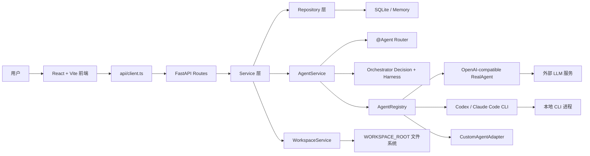

# AgentHub 技术文档

最后更新：2026-06-10  
技术路线：Python-first 后端 + React 前端 + 统一 Agent Adapter

## 1. 总体架构

AgentHub 采用前后端分离架构。前端负责 IM 体验、SSE 消费、artifact 操作和 workspace 展示；后端负责会话持久化、消息流、Agent 调度、LLM/CLI 调用、workspace 文件安全、diff 应用与 preview 路由。



分层原则：

- API route 保持薄层，只做请求接入和 response_model 声明。
- Service 层承接业务流程，例如消息保存、Agent 编排、diff 应用。
- Repository 层屏蔽 SQLite 与 memory 后端差异。
- Agent 统一通过 Adapter 调用，业务层不直接耦合 OpenAI、Codex 或 Claude。
- Workspace 文件操作全部经过路径安全校验。

## 2. 技术栈

| 层级 | 技术 |
| --- | --- |
| 后端框架 | FastAPI |
| 数据校验 | Pydantic v2 |
| 配置 | pydantic-settings |
| 数据库 | SQLite + SQLModel；测试/简单场景支持 memory repository |
| LLM 调用 | httpx AsyncClient，OpenAI-compatible `/chat/completions` |
| CLI Agent | `asyncio.create_subprocess_exec` 调 Codex / Claude Code |
| Diff | `difflib` / 项目内 `workspace.diff` |
| 测试 | pytest、pytest-asyncio |
| 类型与质量 | mypy strict、ruff |
| 前端 | React + Vite + TypeScript |
| UI | Ant Design + 自定义 CSS |
| Markdown | react-markdown + remark-gfm + rehype-sanitize |

## 3. 目录结构

关键目录：

```txt
agenthub/
  main.py                    FastAPI app 入口和 CORS/异常处理
  config.py                  .env 配置
  api/                       HTTP/SSE 路由
  services/                  会话、消息、Agent、workspace 业务层
  repositories/              memory 与 SQLite 数据访问层
  models/                    SQLModel 数据表
  schemas/                   Pydantic API/领域模型
  agents/                    Agent Adapter 实现
  orchestrator/              路由、计划模型、harness 模型
  workspace/                 路径安全、diff、preview、git helper
  core/                      业务错误

frontend/src/
  App.tsx                    全局状态和主业务流
  api/client.ts              后端 API/SSE 客户端
  types/api.ts               前端类型
  components/chat/           聊天流、输入框、Markdown、artifact 操作
  components/conversations/  会话列表、新建会话、成员管理
  components/agents/         Agent 列表、自建 Agent 管理
  components/workspace/      右侧 Workspace 面板
  components/artifactCards/  右侧 Artifact 卡片

tests/
  test_api.py
  test_agents.py
  test_external_cli_agent.py
  test_fastapi_workspace_api.py
  test_sqlite_repositories.py
  ...
```

## 4. 后端 API

### 4.1 Conversation API

- `GET /api/conversations?status=active|archived|all`
- `POST /api/conversations`
- `GET /api/conversations/{id}`
- `PATCH /api/conversations/{id}`
- `DELETE /api/conversations/{id}`

`Conversation` 包含 `status`、`is_pinned`、`agent_ids`、`workspace_id`。归档只影响列表筛选，不删除消息和 workspace。

### 4.2 Message API

- `GET /api/conversations/{conversation_id}/messages`
- `POST /api/conversations/{conversation_id}/messages`
- `POST /api/conversations/{conversation_id}/messages/run`
- `POST /api/conversations/{conversation_id}/messages/stream`
- `DELETE /api/conversations/{conversation_id}/messages/{message_id}`
- `POST /api/conversations/{conversation_id}/messages/{message_id}/pin-context`
- `DELETE /api/conversations/{conversation_id}/messages/{message_id}/pin-context`
- `POST /api/conversations/{conversation_id}/messages/{message_id}/regenerate/stream`

`/messages/stream` 是前端主链路。非流式 `/messages/run` 保留用于兼容测试或调试。

### 4.3 Agent API

- `GET /api/agents`
- `GET /api/agents/runtime`
- `GET /api/agents/backends`
- `POST /api/agents/run`
- `POST /api/agents/stream`
- `GET /api/agents/custom`
- `POST /api/agents/custom`
- `PATCH /api/agents/custom/{agent_id}`
- `DELETE /api/agents/custom/{agent_id}`
- `POST /api/agents/custom/{agent_id}/test`

`/api/agents/runtime` 返回运行模式、provider、model、base_url_host、api_key_configured，不返回密钥。

### 4.4 Workspace API

- `GET /api/workspaces/{workspace_id}/files`
- `GET /api/workspaces/{workspace_id}/files/content?path=...`
- `DELETE /api/workspaces/{workspace_id}/files?path=...`
- `GET /api/workspaces/{workspace_id}/preview`
- `GET /api/workspaces/{workspace_id}/preview-page?path=...`
- `GET /api/workspaces/{workspace_id}/preview-assets/{path}`
- `POST /api/workspaces/{workspace_id}/apply-diff`
- `GET /api/workspaces/{workspace_id}/applied-diffs`
- `POST /api/workspaces/{workspace_id}/applied-diffs/{record_id}/revert`

Preview 使用 `preview-page?path=` 指向具体 HTML 入口，并通过 `preview-assets` 提供同目录资源加载。

## 5. SSE 流式协议

消息流事件固定为：

| 事件 | 作用 |
| --- | --- |
| `user_message` | 用户消息已保存，前端立即插入时间线 |
| `harness_step` | Orchestrator 或 Agent 当前阶段 |
| `agent_started` | 前端创建 Agent draft 气泡 |
| `agent_delta` | 增量追加 Agent 可见文本 |
| `artifact` | 增量发送结构化产物 |
| `agent_done` | 后端已落盘最终 Agent message，前端替换 draft |
| `error` | 可读错误 |
| `done` | 本次运行结束 |

前端在 `App.tsx` 中按 `conversationId` 隔离：

- `messagesByConversationId`
- `agentRunningByConversationId`
- `generationNoticeByConversationId`
- `replyTargetsByConversationId`

这样会话 A 正在生成时切到会话 B，B 不会显示 A 的“正在回复中”状态；切回 A 仍能看到 A 的 draft 或最终消息。

## 6. 数据模型

### 6.1 Conversation

核心字段：

- `id`
- `title`
- `mode: single | group`
- `agent_ids`
- `status: active | archived`
- `is_pinned`
- `workspace_id`
- `created_at`
- `updated_at`

### 6.2 Message

核心字段：

- `id`
- `conversation_id`
- `role: user | agent | system`
- `sender_id`
- `content`
- `artifacts`
- `reply_to_id`
- `regenerated_from_id`
- `is_context_pinned`
- `deleted_at`
- `created_at`

软删除会把内容替换为“消息已删除”、清空 artifacts、取消 pin，但保留时间线位置。Agent history 会过滤 `deleted_at != None` 的消息。

### 6.3 Artifact

Artifact 是模型产物的统一结构：

```python
class Artifact(BaseModel):
    id: str
    type: Literal["code", "diff", "preview", "file", "deploy"]
    title: str
    data: dict[str, Any]
    created_at: datetime
```

常见 data 字段：

- `code`：`filename`、`language`、`content`、`workspace_id`
- `diff`：`filename`、`diff`、`workspace_id`
- `preview`：`workspace_id`、`status`、`preview_url`、`entry_path`
- `file`：`findings`、`risk_level`、`summary` 等通用结构

### 6.4 CustomAgent

核心字段：

- `id`
- `name`
- `description`
- `system_prompt`
- `backend_id`
- `capabilities`
- `is_enabled`
- `created_at`
- `updated_at`

SQLite 使用独立 `customagentrecord` 表。删除自建 Agent 不删除历史消息，历史 sender 名称找不到时回退显示 id。

## 7. Agent Adapter

AgentHub 的核心扩展点是 `AgentAdapter`：

```python
class AgentRunInput(BaseModel):
    conversation_id: str
    workspace_id: str
    user_message: str
    history: list[Message]
    context: dict[str, Any]

class AgentRunResult(BaseModel):
    agent_id: str
    content: str
    artifacts: list[Artifact]
    next_actions: list[str]
```

业务层只依赖这两个模型，不直接调用具体供应商。

### 7.1 RealAgent

`RealAgent` 通过 OpenAI-compatible HTTP 调用 `/chat/completions`。关键能力：

- 统一读取 `AGENT_MODEL`、`AGENT_BASE_URL`、`OPENAI_API_KEY`。
- 支持 timeout 和服务端错误分类。
- 支持 `response_format=json_object`。
- 支持 structured repair：第一次结构化解析失败后，再请求模型修复 JSON。
- 支持非结构化 salvage：从 Markdown/HTML 中提取 code artifact，避免完全丢失产物。
- 不向前端暴露密钥。

### 7.2 Code / Review / Preview Agent

这三个 Agent 是主开发链路的内置角色：

- Code Agent：实现代码和 diff artifact，必要时从 Markdown 代码块中恢复 artifact。
- Review Agent：审查代码、diff、路径风险和功能完整性。
- Preview Agent：基于 workspace preview 状态和前序产物输出可读检查结论。

### 7.3 OrchestratorAdapter

Orchestrator 优先调用 LLM 生成 `OrchestratorDecision`：

```txt
mode = chat | plan
content = Markdown
plan = OrchestratorPlan | null
```

如果结构化失败，会尝试 relaxed text 决策和文本计划恢复；最终由 `AgentService` 做安全兜底，开发类请求继续进入内置 harness，普通聊天返回自然回复。

### 7.4 ExternalCliAgentAdapter

Codex 和 Claude Code 通过同一个 CLI Adapter 接入：

- 创建临时 workspace 副本。
- 在临时目录中运行 CLI。
- 对比运行前后快照。
- 将文本文件变化转换为 `code` 和 `diff` artifact。
- 不直接修改真实 workspace，仍需要用户 Apply Diff。

当前实现偏向文本文件产物；PDF、图片、Office 等二进制复杂产物需要后续 file artifact 存储和打开能力。

### 7.5 CustomAgentAdapter

自建 Agent 从数据库读取 `system_prompt` 和 `backend_id`：

- OpenAI-compatible：复用全局 LLM 配置。
- Codex CLI：使用本地 `codex exec`。
- Claude Code CLI：使用本地 `claude --print`。
- Mock 模式：返回可识别的 mock 回复，便于离线测试。

## 8. Orchestrator Harness

开发任务链路由 `AgentService` 控制：

```txt
route message
-> decide orchestrator
-> build plan message
-> run child task
-> verify artifacts
-> retry once if failed
-> continue or fail visibly
```

默认校验规则：

- Code Agent 必须返回 `code` 或 `diff` 产物。
- Review Agent 必须返回 findings/risk 类内容。
- Preview Agent 必须返回 preview 状态或 preview artifact。

Harness 通过 `harness_step` 告诉前端当前阶段，但最终不强制输出冗长汇总，避免聊天流被内部报告污染。

## 9. Workspace、Diff 与 Preview

### 9.1 路径安全

所有 workspace path 都经过 `normalize_workspace_file_path` 和 `resolve_workspace_path`，防止 `../` 越权访问。真实文件根目录由 `WORKSPACE_ROOT` 配置。

### 9.2 Apply Diff

`WorkspaceService.apply_diff()` 做以下事情：

1. 从 unified diff 解析目标路径。
2. 读取当前文件内容。
3. 调用 diff apply 逻辑生成新内容。
4. 写入真实 workspace 文件。
5. 保存 `AppliedDiffRecord`，记录 before/after 内容。
6. 选择 preview 入口文件。
7. 返回 `preview_url`、`entry_path`、`applied_at`。

### 9.3 Revert Diff

`revert_applied_diff()` 使用 AppliedDiffRecord 中的 before/after 快照：

- 如果当前内容不等于 after，说明用户后续又改过，返回冲突错误。
- 如果原文件存在，则恢复 before 内容。
- 如果原文件不存在，则删除本次 diff 新建文件。
- 更新 preview 状态。

### 9.4 Preview

`preview-page?path=` 支持指定 HTML 文件。后端会注入 `<base href="...preview-assets/...">`，使嵌套页面的相对 CSS/JS 路径能正确加载。

## 10. 前端核心实现

### 10.1 App 状态

`frontend/src/App.tsx` 是前端主流程中心，负责：

- 初始化会话、Agent、runtime。
- 按会话加载消息、preview、workspace 文件、applied diff。
- 处理 SSE 流并维护 draft。
- 处理 Apply/Revert Diff。
- 管理消息引用、删除、pin、重新生成。
- 打开新建会话、成员管理、自建 Agent 管理弹窗。

### 10.2 ChatPanel

`ChatPanel` 负责展示：

- 会话标题和 workspace id。
- 消息气泡、头像、时间、操作按钮。
- 引用预览。
- Markdown 渲染。
- 内联 artifact 操作卡片。
- 生成中状态卡片。
- 输入框和 `@` 菜单。

自动滚动到底部依赖 `messageEndRef` 和消息长度变化，解决流式输出后用户被带回顶部的问题。

### 10.3 Artifact 渲染

聊天内使用 `MessageArtifactActions`，右侧使用 `ArtifactRenderer`。二者共享 artifact 数据结构，但呈现粒度不同：

- 聊天内强调可执行动作：Apply Diff、打开预览、复制代码。
- 右侧面板强调聚合查看：代码、Diff、Preview、通用 JSON。

### 10.4 自建 Agent 管理

`CustomAgentManagerModal` 调用：

- `listCustomAgents`
- `listAgentBackends`
- `createCustomAgent`
- `updateCustomAgent`
- `deleteCustomAgent`
- `testCustomAgent`

测试输出使用 Markdown 渲染，避免把 `**标题**` 这类 Markdown 字符串原样展示。

## 11. 配置

关键 `.env` 字段：

```txt
PERSISTENCE_BACKEND=sqlite
DATABASE_URL=sqlite:///./agenthub.db
WORKSPACE_ROOT=./workspaces
USE_MOCK_AGENTS=false
AGENT_PROVIDER=openai-compatible
AGENT_MODEL=gpt-4o-mini
AGENT_BASE_URL=https://api.openai.com/v1
OPENAI_API_KEY=
AGENT_RESPONSE_FORMAT=json_object
AGENT_ALLOW_FALLBACKS=false
CODE_AGENT_BACKEND_ID=openai-compatible
CODEX_CLI_PATH=codex
CLAUDE_CODE_CLI_PATH=claude
ANTHROPIC_API_KEY=
```

安全约束：

- `.env` 不提交。
- 前端不直接请求 LLM API。
- Runtime API 只返回是否配置 key，不返回 key 内容。
- CLI 调用使用参数列表，不使用 shell 拼接。

## 12. 测试覆盖

当前测试文件覆盖：

- API：会话、消息、Agent、自建 Agent、workspace route。
- Agent：Mock/Real parsing、Orchestrator、Code/Review/Preview、CLI adapter。
- Workspace：路径安全、文件读写、diff apply、preview assets、revert。
- SQLite：模型迁移、持久化读写。
- Git helper：受限 git 操作。

推荐验证命令：

```bash
.venv/bin/python -m pytest -q
.venv/bin/python -m ruff check agenthub tests scripts
.venv/bin/python -m ruff format --check agenthub tests scripts
.venv/bin/python -m mypy agenthub
cd frontend && npm run build
```

## 13. 关键架构取舍

### 13.1 为什么 Python-first

Agent 调度、LLM 调用、文件系统、diff、preview、CLI 进程管理都更适合放在 Python 后端。React 只承担复杂 IM UI，这比全栈 Node 或纯 Python UI 更稳。

### 13.2 为什么要 Adapter

没有 Adapter 时，业务代码会直接依赖 OpenAI、Codex、Claude 的细节。现在 AgentService 只关心 `AgentRunInput -> AgentRunResult`，后续添加 OpenCode 或其他平台只需新增 Adapter。

### 13.3 为什么 Apply Diff 需要用户确认

Agent 生成代码不等于应该直接写入真实 workspace。Apply Diff 把“AI 建议”和“用户确认”分开，既适合 Demo，也降低误写文件风险。

### 13.4 为什么 Orchestrator 既要 LLM 又要兜底

纯规则拆解不够智能，但 LLM 结构化输出不稳定。当前设计是 LLM 决策优先，结构化失败时 repair/归一化，最后才安全兜底，保证主链路能演示。


